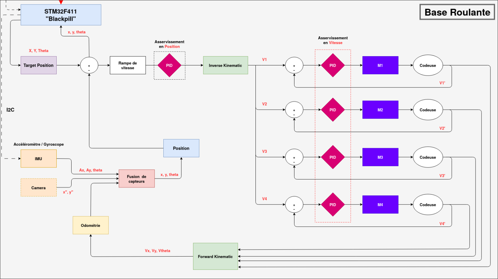

# Asservissement

---

- *Fichiers : `asserv.c`, `asserv.h`, `main.c`*

Bienvenue dans ce court chapitre dédié à **l'asservissement des déplacements du robot**.

Dans cette ce chapitre, je vais vous expliquer **le fonctionnement global de notre système d'asservissement**, ainsi que la manière dont les différents éléments interagissent pour permettre un déplacement précis et contrôlé.

L'objectif est de vous donner **une vision d'ensemble** dès le départ, car une compréhension globale du système facilitera l'assimilation des détails techniques abordés par la suite.

Dans les **chapitres suivants**, nous reviendrons plus en détail sur **le fonctionnement spécifique de chaque composant** impliqué dans cet asservissement.

## Fonctionnement général

Pour vous aider à **visualiser les différents éléments et leurs interactions**, voici un diagramme que j'ai réalisé l'année dernière. Je pense qu'il **représente fidèlement** ce que je souhaite vous expliquer.

Voici le **fonctionnement logique séquentiel** de notre base roulante pour exécuter un déplacement ou une rotation :

1. **Calcul de l'écart** : On compare la **position cible** avec la **position actuelle** du robot pour déterminer la **distance euclidienne** et l'**angle** séparant le robot de son objectif.

2. **Asservissement en position** : Ces écarts sont traités par un **contrôleur PID** dédié à l'asservissement en position. Celui-ci génère les **vitesses cibles** que le robot doit adopter selon ses trois axes de mouvement. Un **profil de vitesse** est appliqué pour adoucir les transitions et respecter les **contraintes mécaniques** (vitesse maximale, accélération progressive, etc.).

3. **Conversion cinématique** : Les vitesses du robot sont ensuite **converties** en consignes individuelles pour chaque moteur, en utilisant le **modèle cinématique** de la base roulante.

4. **Asservissement en vitesse des moteurs** : Chaque moteur est asservi en vitesse via un **PID dédié**, afin de suivre précisément la vitesse cible qui lui est assignée.

5. **Génération des commandes moteur** : L'asservissement produit des **signaux de commande**, qui sont directement appliqués aux moteurs pour effectuer le mouvement.

6. **Mesure des déplacements** : Pendant le mouvement, les **encodeurs** mesurent le déplacement effectif du robot selon chacun de ses axes.

7. **Mise à jour de la position** : Grâce à **l'odométrie**, ces mesures sont utilisées pour **recalculer la position actuelle** du robot, en se basant sur sa dernière position connue.

8. **Fusion de capteurs** : Si disponible, on **combine les données** provenant de plusieurs sources (odométrie, IMU, caméra) pour **affiner l'estimation de la position**. Cela permet de **réduire les erreurs**, limiter la dérive et éviter l'accumulation d'imprécisions au fil du temps.

9. **Boucle de contrôle** : L'ensemble de ce processus est **répété à intervalles réguliers** (par exemple, toutes les **10 ms**), assurant ainsi un suivi continu et une correction en temps réel.

## Ressources et Références

- [Atelier asservissement CUBOT](https://github.com/VRAC-team/la-maxi-liste-ressources-eurobot/blob/master/asservissement/Cubot-atelier_asservissement.pdf)
- [Ressources Asservissement](https://github.com/VRAC-team/la-maxi-liste-ressources-eurobot?tab=readme-ov-file#25-asservissement)
- [Asservissement en Vitesse](https://www.eurobot.org/wiki/fr/informatics/asservir_les_moteurs_en_vitesse)
