# Base roulante

---

## Introduction

**Bienvenue dans cette partie du wiki dédiée à la base roulante.**

Dans les chapitres suivants, je vais tenter de vous présenter **tout ce qu’il faut savoir** pour :

- **Comprendre le fonctionnement** de la base roulante.
- **Découvrir des outils et des concepts avancés** que j’aurais aimé implémenter (gestion de trajectoires, fusion de capteurs, asservissement de position optimisé).
- **Vous donner un aperçu de ce qui se fait de mieux** (à ma connaissance) pour concevoir une base roulante **complète et performante**.

### Organisation des chapitres

Chaque chapitre aborde :

- **Un élément clé du code**, avec les fichiers concernés indiqués en en-tête.
- **Un aspect fonctionnel** de la base roulante, qu’il soit **électronique** (capteurs, actionneurs) ou **numérique** (asservissement, odométrie).
- **Des explications détaillées** sur chaque élément : son rôle, son utilité, et les raisons de sa présence.
- **Des suggestions, des précisions et des pistes d’amélioration** pour aller plus loin.

### Ressources et références

À la fin de chaque chapitre, vous trouverez :

- **Des ressources complémentaires** pour approfondir le sujet.
- **Des références** qui ont inspiré ou guidé mes recherches.

> [!TIP] Ressources recommandées
> Pour approfondir ce sujet, je vous **conseille vivement** de consulter les **références générales** disponibles en bas de page. Ces ressources couvrent **l'ensemble des concepts clés** liés à la robotique dans le cadre de la **Coupe de France**. Elles seront utiles **non seulement pour cette section**, mais aussi pour **l'ensemble du projet**.

---

> [!NOTE]
> Ce wiki est conçu pour être **condensé et accessible**, mais il ne couvre pas tous les aspects en détail. Je vous encourage vivement à consulter les ressources proposées pour **construire une vision globale** de la manière dont ces éléments s’articulent pour former une base roulante performante.

**Bonne lecture !** 🚀

> [!INFO] À propos du style d'écriture
> Je tiens à préciser que mon niveau d'écriture n'est pas excellent. Bien que le **contenu** soit de moi, j'ai utilisé une IA pour reformuler une grande partie du texte de ce chapitre. Ne soyez donc pas surpris si le **ton** ou le **style** vous semblent particuliers.

## Struture de cette Documentation

La documentation de cette section est organisée comme suit :

### Essentiels

Cette catégorie regroupe plusieurs chapitres couvrant des **notions générales et fondamentales** pour comprendre le code et le reste de la documentation. Vous y trouverez :

- La **configuration du projet**, notamment via les **constantes globales**.
- Le **mécanisme des interruptions**.
- La **communication sur STM32**.

### Présentation des capteurs et actionneurs

Je vous présente brièvement les différents **capteurs** et **actionneurs** (en l'occurrence, les **moteurs**) utilisés avec la **base roulante**.

### Asservissement de la base roulante

Cette partie centrale aborde l'**asservissement** de notre base roulante, permettant d'effectuer des **mouvements rapides et précis** pour se déplacer d'un point à un autre.

### Annexes

Enfin, en annexe, j'aborderai des **sujets complémentaires** ou des extraits de code qui ne sont pas directement liés à un thème unique, comme :

- Le **système de logs** que j'ai mis en place.
- Des **améliorations à implémenter**, notamment pour optimiser les **déplacements du robot**.

## Structure du Projet

### Vue d'ensemble

L'ensemble des fichiers essentiels du projet est organisé dans le répertoire **`Core`**. Voici leur répartition :

- **`Core/Src`** : Contient le **code source** (fichiers `.c`).
    - Ces fichiers implémentent la logique du code et définissent les fonctions.
- **`Core/Inc`** : Contient les **en-têtes** (fichiers `.h`).
    - Ces fichiers déclarent les fonctions, ainsi que les **constantes** et **macros** éventuelles.

Le répertoire **`Drivers`** contient, quant à lui, les fichiers spécifiques à **STM32** et à la carte cible du projet.

Dans ce cas précis, il s'agit des fichiers de configuration et de programmation pour le microprocesseur **[STM32F411CEU6](https://www.st.com/en/microcontrollers-microprocessors/stm32f411ce.html)**, utilisé sur la carte **[STM32 Blackpill](https://stm32world.com/wiki/Black_Pill)**.

### Description des fichiers sources

*`Inc/`*

- **`defines.h`** : Définit l'ensemble des **constantes globales** du projet.
- Les autres fichiers `.h` sont associés aux fichiers sources `.c` portant le même nom.

*`Src/`*

- **`altimu.c`** : Fonctions pour communiquer avec Altimu10-v4
- **`asserv.c`** : Fonctions pour l'asservissement
- **`encoders.c`** : Fonctions pour lire les encodeurs rotatifs
- **`fusion.c`** : *(Non utiliser - destiné à la fusion de capteurs)*
- **`imu.c`** : Fonctions pour communiquer avec le MPU-9050
- **`log.c`** : Fonctions pour le système de logs
- **`main.c`** : Point d'entrée principal du programme.
- **`mainprog.c`** : Programme et boucle principale
- **`moteurs.c`** : Fonctiond pour le contrôle des moteurs
- **`odometrie.c`** : Fonctions liées au calculs de l'odometrie
- **`pid.c`** : Implémentation du PID
- **`stm32f4xx_hal_msp.c`** : Configuration matérielle spécifique à STM32.
- **`stm32f4xx_it.c`** : Gestion des interruptions pour STM32.
- **`strategie.c`** : *(Non utiliser - destiné à l'implémentation de la routine le cas-échéant)*
- **`system_stm32f4xx.c`** : Configuration système pour STM32.
- **`temps.c`** : *(Non utiliser)*
- **`trajectoires.c`** : *(Non utiliser - destiné à implémenter des trajctoires complexes)*
- **`trajet.c`** : *(Non utiliser - destiné à la gestion des trajectoires)*
- **`uart.c`** : Gestion de la communication série (UART).

## Strcuture du Robot

Le schéma ci-dessous illustre de manière graphique l'architecture globale de notre robot, ainsi que la façon dont les différents éléments sont connectés et interagissent au sein de cette structure. On y trouve également la partie dédiée à la base roulante.

## Ressources et Références

> [!SUCCESS] La meilleur de toutes
> [Maxi liste ressources Eurobot](https://github.com/VRAC-team/la-maxi-liste-ressources-eurobot)

- [STM32 Wiki for MCUs](https://wiki.st.com/stm32mcu)
- [PythonRobotics](https://github.com/AtsushiSakai/PythonRobotics)
- [Other STM32 Wiki](https://stm32world.com/wiki/Main_Page)
- [Holonome](https://julienbayle.github.io/stardust/pages/move_1_velocity_and_odometry.html)
- [Keuronde](https://git.poivron-robotique.fr/Keuronde)
- [Exemple Code](https://github.com/Keuronde/RPiPico-Holonome2023)
- [Poivron Robotique](https://poivron-robotique.fr/Consigne-de-vitesse.html)
- [Wiki Eurobot](https://www.eurobot.org/wiki/fr/informatics/de_l_art_de_deplacer_son_robot_avec_classe)
