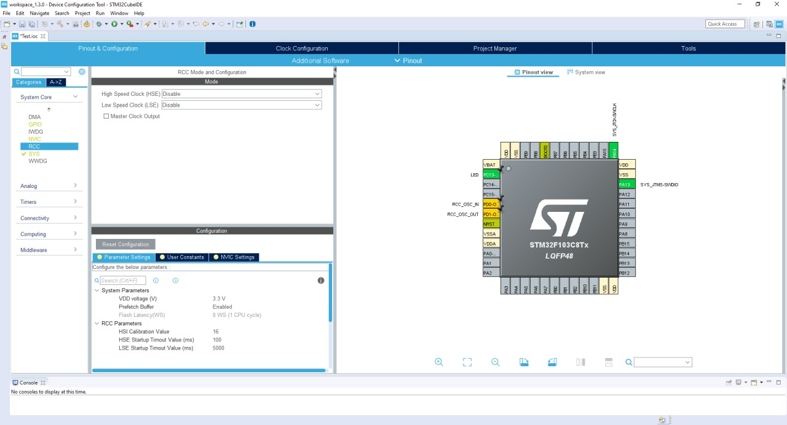
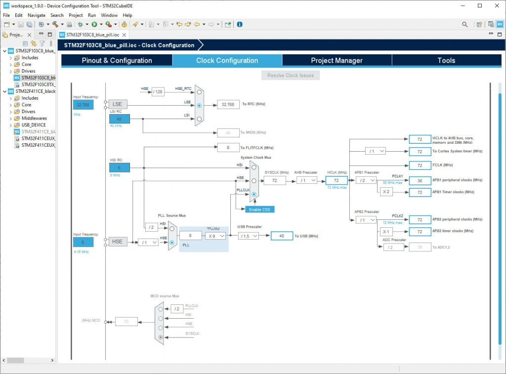

# STM32CubeIDE

---

Bienvenue dans ce chapitre dédié à la présentation du logiciel **STM32CubeIDE**.

Je vais vous expliquer :

- **Comment l'utiliser** efficacement.
- **Les éléments les plus importants** de l'interface.
- Les **différents menus et sous-menus**, ce qu'ils permettent de configurer et à quoi ils servent.

Ces informations sont basées sur mes connaissances, acquises à la fois grâce à **Projet&Tech.**, ainsi qu'aux **cours d'électronique** avec M. Goatailler. Je partagerai avec vous ce que je maîtrise, dans la limite de mes compétences.

## Téléchargement et Installation

### Prérequis

- **Système d'exploitation** : Windows (7/10/11), Linux (Ubuntu, Debian, etc.), ou macOS.
- **Espace disque** : Au moins 2 Go d'espace libre.
- **Droits administrateur** : Nécessaires pour l'installation.

---

### Téléchargement de STM32CubeIDE

#### Accéder à la page officielle

Rendez-vous sur le site officiel de STMicroelectronics :
🔗 [STM32CubeIDE - STMicroelectronics](https://www.st.com/en/development-tools/stm32cubeide.html)

#### Choisir la version

- Sélectionnez la version adaptée à votre système d'exploitation (Windows, Linux, macOS).
- Cliquez sur **"Get Software"** pour télécharger le fichier d'installation.

---

### Installation

#### Sur Windows

1. **Exécuter le fichier téléchargé** : Double-cliquez sur le fichier `.exe` téléchargé (ex: `st-stm32cubeide_<version>.exe`).

2. **Suivre l'assistant d'installation** :
      - Acceptez les termes de la licence.
      - Choisissez le répertoire d'installation (par défaut : `C:\ST\STM32CubeIDE`).
      - Sélectionnez les composants à installer (laissez les options par défaut si vous débutez).
      - Cliquez sur **"Install"** pour lancer l'installation.

3. **Finaliser l'installation** :
      - Une fois l'installation terminée, cliquez sur **"Finish"**.
      - L'IDE peut être lancé depuis le menu Démarrer ou via un raccourci sur le bureau.

---

#### Sur Linux (Ubuntu/Debian)

1. **Extraire l'archive téléchargée** :
   Ouvrez un terminal et exécutez :

    ```bash
    tar -xzf st-stm32cubeide_<version>.tar.gz -C /opt/
    ```

2. **Lancer l'installation** :

    ```bash
    cd /opt/stm32cubeide_<version>
    ./SetupSTM32CubeIDE-linux_x86_64.<version>.run
    ```

3. **Suivre les instructions** :
      - Acceptez la licence.
      - Choisissez le répertoire d'installation.
      - Sélectionnez les composants à installer.
      - Cliquez sur **"Install"**.

4. **Créer un raccourci (optionnel)** :

    ```bash
    sudo ln -s /opt/stm32cubeide_<version>/stm32cubeide /usr/local/bin/stm32cubeide
    ```

---

### Première utilisation

- Au premier lancement, STM32CubeIDE peut vous demander de configurer un espace de travail (workspace). Choisissez un dossier vide pour vos projets.
- Vous pouvez maintenant créer un nouveau projet ou importer un exemple depuis la bibliothèque STM32Cube.

## Nouveau projet

### Créer un nouveau projet STM32

1. **Accéder à l'assistant de création de projet** :
      - Cliquez sur **File > New > STM32 Project** dans la barre de menu.

2. **Sélectionner la cible** :
      - Dans la fenêtre **"Target Selection"**, utilisez la barre de recherche pour taper **STM32F411CEU**.
      - Sélectionnez la carte ou le microcontrôleur **STM32F411CEU6** (ou **STM32F411CEUx** selon la référence exacte de votre MCU).
      - Cliquez sur **"Next"**.

---

### Configurer le projet

1. **Nommer le projet** :
      - Donnez un nom à votre projet (ex: `STM32F411_Blinky`).
      - Choisissez un emplacement pour enregistrer le projet (workspace).
      - Cliquez sur **"Next"**.

2. **Configurer le MCU** :
      - STM32CubeIDE ouvre l'interface **"Pinout & Configuration"** (ou **"Device Configuration Tool"**).
      - Ici, vous pouvez configurer les broches (GPIO), les périphériques (UART, SPI, I2C, etc.), et les horloges (Clock Configuration).

---

### Configurer les broches et périphériques

1. **Configurer une LED (exemple : PA5)** :
      - Dans l'onglet **"Pinout"**, recherchez la broche **PA5**.
      - Cliquez sur la broche et sélectionnez **"GPIO_Output"**.
      - Donnez un nom à cette broche (ex: `USER_LED`).

2. **Configurer l'horloge** :
      - Allez dans l'onglet **"Clock Configuration"**.
      - Sélectionnez une source d'horloge (ex: **HSI** ou **HSE** selon votre matériel).
      - Configurez la fréquence système (ex: **84 MHz** pour le STM32F411).
      - Cliquez sur **"Apply"** pour valider.

---

### Générer le code initial

1. **Générer le code** :
      - Cliquez sur l'onglet **"Project Manager"**.
      - Dans **"Project"**, assurez-vous que le nom du projet est correct.
      - Dans **"Code Generator"**, vérifiez que les options sont cochées (ex: **"Generate peripheral initialization as a pair of '.c/.h' files per peripheral"**).
      - Cliquez sur **"GENERATE CODE"**.

---

### Écrire le code en C

1. **Ouvrir le fichier `main.c`** :
      - Dans l'explorateur de projet, allez dans **Src > main.c**.

2. **Ajouter votre code** :
      - Dans la fonction `main()`, après l'initialisation (`MX_GPIO_Init()`, `MX_USART1_UART_Init()`, etc.), ajoutez votre logique.
      - Exemple pour faire clignoter une LED sur PA5 :

        ```c
        while (1) {
            HAL_GPIO_TogglePIN(USER_LED_GPIO_Port, USER_LED_Pin);
            HAL_Delay(500); // Délai de 500 ms
        }
        ```

---

## Compiler et flasher le projet

1. **Compiler le projet** :
      - Cliquez sur l'icône **"Build"** (marteau) ou appuyez sur **Ctrl + B**.
      - Vérifiez qu'il n'y a pas d'erreurs dans la console.

2. **Flasher le MCU** :
      - Branchez votre carte de développement (ex: Nucleo, Discovery) via USB.
      - Cliquez sur l'icône **"Run > Debug"** (ou appuyez sur **F11**).
      - Sélectionnez **"STM32 Cortex-M C/C++ Application"** et cliquez sur **"OK"**.
      - STM32CubeIDE va compiler, flasher et lancer le débogage.

> [!SUCCESS]
> Si tout est correct, la LED connectée à PA5 devrait clignoter toutes les 500 ms.

## Configuration du MCU (STM32)

Pour configurer une carte **STM32**, le fichier `.ioc` doit être ouvert avec **STM32CubeIDE**. Vous accédez alors à une **interface graphique** affichant :

- Une **représentation visuelle** du microcontrôleur.
- Une **carte des broches (PIN)** et de leurs états.

### Illustration



### Fonctionnalités principales

Cette interface permet de **configurer chaque broche** (activation, désactivation, entrée/sortie, etc.).

### Onglets principaux

En haut de l’interface, vous trouverez **4 onglets** :

- **Pinout & Configuration** (page par défaut)
- **Clock Configuration** (configuration des horloges)
- **Project Manager** (gestion du projet)
- **Tools** (outils supplémentaires)

> [!TIP] Remarque
> Pour ma part, j’ai principalement utilisé **les deux premiers onglets** de STM32CubeIDE. Ceux-ci sont, à mon sens, **les plus importants**, car ils sont entièrement dédiés à la **configuration matérielle de la carte**.

### Sous-menus utiles (à gauche)

#### Pinout & Configuration

Parmi les **6 sous-menus** disponibles, **4 sont particulièrement pertinents** dans notre projet :

- **System Core** : Configuration du cœur du système (interruptions, modes de veille, etc.).
- **Timers** : Gestion des temporisateurs et des PWM.
- **Analog** : Configuration des entrées/sorties analogiques (ADC, DAC, etc.).
- **Connectivity** : Paramétrage des interfaces de communication (UART, SPI, I2C, etc.).

#### Clock Configuration

##### Illustration de l'onglet



## Déboggage

---

### Lancer le mode débogage

- Branchez votre carte STM32 (ex: Nucleo-F411CE) à votre PC via USB.
- Dans STM32CubeIDE, cliquez sur l'icône **"Debug"** (ou appuyez sur **F11**).
- Sélectionnez **"STM32 Cortex-M C/C++ Application"** dans la liste des configurations de débogage.
- Cliquez sur **"OK"** pour démarrer la session de débogage.
- STM32CubeIDE va compiler le projet, flasher le MCU et démarrer le débogage.

---

### Utiliser les points d'arrêt (breakpoints)

- Dans l'éditeur de code, cliquez sur la marge gauche (à côté du numéro de ligne) pour ajouter un **point d'arrêt** (un cercle bleu apparaît).
- Exécutez le programme en mode débogage (**F8** pour reprendre l'exécution après un breakpoint).
- Le programme s'arrêtera à chaque breakpoint, permettant d'inspecter l'état du MCU.

---

### Visualiser les variables en temps réel

- Pendant le débogage, ouvrez l'onglet **"Debug"** en bas de l'IDE.
- Allez dans la vue **"Variables"** pour voir les valeurs actuelles des variables locales et globales.
- Pour ajouter une variable spécifique à surveiller :
    - Cliquez droit dans la vue **"Expressions"**.
    - Sélectionnez **"Add Watch Expression"**.
    - Entrez le nom de la variable (ex: `ma_variable`) et validez.

---

### Utiliser la vue "Live Watch"

- STM32CubeIDE permet de surveiller des variables en temps réel pendant l'exécution.
- Dans l'onglet **"Debug"**, ouvrez la vue **"Live Watch"**.
- Ajoutez les variables ou expressions à surveiller (ex: `GPIOA->ODR` pour voir l'état des broches de sortie).
- Les valeurs seront mises à jour en temps réel pendant l'exécution du programme.

---

### Visualiser les registres du MCU

- Dans l'onglet **"Debug"**, ouvrez la vue **"Registers"**.
- Vous pouvez voir les registres du Cortex-M4 (ex: R0, R1, PC, SP) et les registres périphériques (ex: GPIOA, USART1).
- Pour filtrer les registres, utilisez la barre de recherche en haut de la vue.

---

### Utiliser la vue "Memory" pour inspecter la RAM/Flash

- Dans l'onglet **"Debug"**, ouvrez la vue **"Memory"**.
- Entrez une adresse mémoire (ex: `0x20000000` pour le début de la RAM) ou un symbole (ex: `&ma_variable`).
- Vous pouvez visualiser le contenu en hexadécimal, décimal ou binaire.

---

### Contrôler l'exécution pas à pas

- **F5 (Step Into)** : Exécute une instruction à la fois, en entrant dans les fonctions.
- **F6 (Step Over)** : Exécute une instruction à la fois, sans entrer dans les fonctions.
- **F7 (Step Return)** : Exécute jusqu'à la fin de la fonction actuelle.
- **F8 (Resume)** : Reprend l'exécution normale jusqu'au prochain breakpoint.

---

### Utiliser le "Live Expressions" pour le monitoring avancé

- Dans la vue **"Live Expressions"**, ajoutez des expressions complexes (ex: `ma_variable > 10`).
- STM32CubeIDE évaluera ces expressions en temps réel et affichera le résultat.
- Utile pour surveiller des conditions spécifiques ou des calculs intermédiaires.

---

### Exporter les données de débogage

- Pour sauvegarder les valeurs des variables ou des registres :
    - Cliquez droit dans la vue **"Variables"** ou **"Registers"**.
    - Sélectionnez **"Export"** et choisissez un format (ex: CSV, TXT).
- Ces données peuvent être analysées ultérieurement avec un tableur ou un outil d'analyse.

---

### Débogage avec des périphériques externes (SWO)

- Pour utiliser la trace SWO (Serial Wire Output) :
    - Assurez-vous que votre carte supporte SWO (ex: STM32F4 Discovery).
    - Dans **"Debug Configuration"**, activez la trace SWO et configurez la fréquence.
    - Utilisez la vue **"SWO Trace"** pour visualiser les messages de trace en temps réel.

> [!BUG] Limitation du SWO
> Dans notre configuration, **le SWO (Serial Wire Output) n'est pas disponible**. En effet, nous n'utilisons pas le **programmeur officiel STM32 ST-Link V2**, mais un outil portant le même nom, bien moins coûteux et tout aussi fonctionnel.
>
> Il est techniquement possible d'activer le SWO sur ce ST-Link non officiel, mais cela nécessite une **soudure complexe**, dont l'utilité ne justifie pas la difficulté.
>
> Pour pallier cette limitation, je vous invite à utiliser **les outils de visualisation** que nous avons mis en place pour obtenir des fonctionnalités similaires.

---

### Résolution des problèmes courants

- **Le débogage ne démarre pas** : Vérifiez la connexion USB et que le MCU est alimenté. Essayez de redémarrer la carte.
- **Les variables ne s'affichent pas** : Assurez-vous que le code est compilé avec les symboles de débogage (option `-g` activée).
- **Les valeurs ne se mettent pas à jour** : Vérifiez que le programme est en cours d'exécution et non en pause.
- **Erreurs de connexion** : Vérifiez que le port de débogage (SWD/JTAG) est correctement configuré dans les paramètres du projet.

---

### Astuces pour un débogage efficace

- Utilisez des **breakpoints conditionnels** pour arrêter l'exécution uniquement si une condition est remplie (ex: `ma_variable == 5`).
- Ajoutez des **messages de trace** avec `printf` (via UART) ou utilisez la fonction `ITM_SendChar` pour SWO.
- Pour les projets complexes, utilisez des **points de trace** (tracepoints) pour enregistrer des données sans arrêter l'exécution.

> [!TIP] Redirection de `printf()` vers l'UART
> Pour en savoir plus sur la **redirection de la fonction `printf()` vers l'UART**, je vous invite à consulter :
>
> - Le **chapitre sur les utilitaires**.
> - Le **chapitre sur la communication**.
>
> Vous y trouverez des **détails et précisions** sur ce sujet.

---

## Ressources et Références

- [STM32CubeIDE User Guide](https://www.st.com/resource/en/user_manual/um2609-stm32cubeide-user-guide-stmicroelectronics.pdf)
- [Creating an STM32 Project Using CubeIDE Step by Step](https://beartronix.com/creating-an-stm32-project-using-cubeide-step-by-step/)
